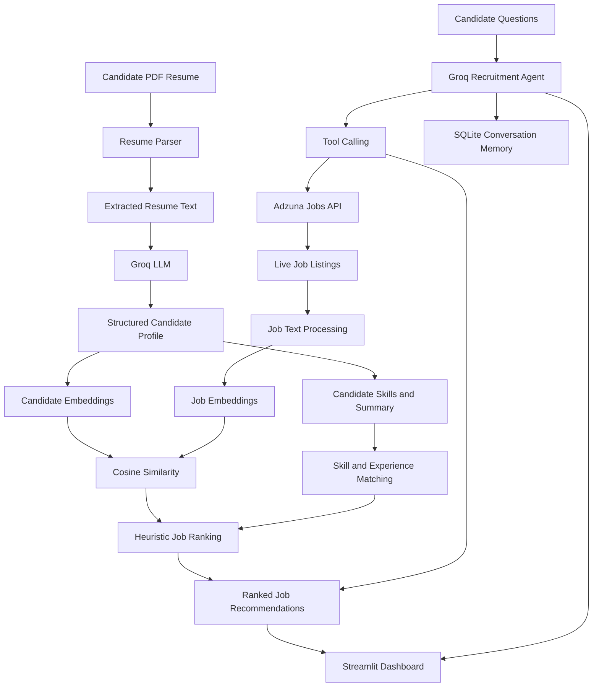

# 🧠 HireMind AI — AI-Powered Recruitment Assistant

**Discover relevant opportunities. Understand your skills. Make smarter career decisions.**

HireMind AI is an AI-powered recruitment assistant that analyzes candidate resumes, extracts structured professional profiles, discovers live job opportunities, and ranks them according to candidate-job compatibility.

Built with Python, Streamlit, Groq, Sentence Transformers and the Adzuna Jobs API, the application combines LLM-powered information extraction, semantic search, heuristic ranking and conversational AI to simplify the job discovery process.

---

## ✨ Key Features

### 1. Resume Parsing & AI Profile Extraction
- Upload PDF resumes through an interactive Streamlit interface.
- Extract resume text using PyMuPDF.
- Use Groq-powered LLM extraction to identify structured candidate information.
- Extract professional summaries, technical skills, education, experience and projects.
- Validate structured profile information using Pydantic models.

### 2. Semantic Job Matching
- Generate text embeddings using Sentence Transformers.
- Use the `all-MiniLM-L6-v2` embedding model.
- Represent candidate profiles and job descriptions as numerical vectors.
- Calculate cosine similarity to identify relevant opportunities.
- Rank jobs using semantic relevance, skill overlap and experience compatibility.

### 3. Live Job Discovery
- Fetch real job listings through the Adzuna Jobs API.
- Support location-based job searches.
- Rank retrieved opportunities against the candidate profile.
- Display company names, job descriptions, locations, match scores and application links.

### 4. AI Recruitment Assistant
- Conversational recruitment assistant powered by Groq.
- Function/tool calling for job search, job details and job comparison.
- Uses candidate profile information to provide contextual responses.
- Maintains conversation history using SQLite.
- Supports follow-up questions about previously discovered opportunities.

### 5. Evaluation Metrics
Implemented recommendation evaluation functions:
- Precision@K
- Recall@K
- Mean Reciprocal Rank (MRR)

These functions provide a foundation for evaluating recommendation quality using a labeled relevance dataset.

---

## 🛠️ Tech Stack

| Category | Technologies |
|---|---|
| Language | Python |
| Frontend | Streamlit |
| LLM Integration | Groq API |
| LLM Model | Configurable through `GROQ_MODEL` |
| Resume Parsing | PyMuPDF |
| Structured Extraction | Pydantic |
| Embeddings | Sentence Transformers |
| Embedding Model | all-MiniLM-L6-v2 |
| Similarity Search | NumPy, Cosine Similarity |
| Job Data | Adzuna Jobs API |
| Database | SQLite |
| Data Processing | NumPy, Pandas |
| Testing | Pytest |
| Configuration | Python-dotenv |
| Version Control | Git, GitHub |

---

## 🏗️ System Architecture



---

## ⚙️ Job Ranking Algorithm

HireMind AI combines three signals to calculate a heuristic job match score.

| Matching component | Weight |
|---|---:|
| Semantic similarity | 55% |
| Skill overlap | 30% |
| Experience compatibility | 15% |

The ranking formula is:

\[
Score = 0.55S + 0.30K + 0.15E
\]

Where:

- \(S\) = Semantic similarity score
- \(K\) = Skill matching score
- \(E\) = Experience compatibility score

The resulting score is used to rank job opportunities by estimated profile relevance.

**Note:** These are heuristic ranking weights, not trained model parameters or probabilities of getting hired.

---

## 📁 Project Structure

```text
HireMindAI/
│
├── app.py
│
├── src/
│   ├── __init__.py
│   ├── resume_parser.py
│   ├── llm_extractor.py
│   ├── embeddings.py
│   ├── vector_store.py
│   ├── job_ranker.py
│   ├── job_fetcher.py
│   ├── tools.py
│   ├── agent.py
│   ├── memory.py
│   └── evaluator.py
│
├── data/
│   ├── jobs.json
│   └── hiremind.db
│
├── tests/
│   ├── test_resume_parser.py
│   ├── test_llm_extractor.py
│   ├── test_embeddings.py
│   ├── test_vector_store.py
│   ├── test_job_ranker.py
│   ├── test_job_fetcher.py
│   ├── test_tools.py
│   ├── test_agent.py
│   ├── test_memory.py
│   └── test_evaluator.py
│
├── .env.example
├── .gitignore
├── requirements.txt
└── README.md
```

*The structure above describes the intended project organization; adjust filenames if your actual repository differs.*

---

## 🚀 Getting Started

### Prerequisites

- Python 3.11 or later
- Git
- Groq API key
- Adzuna API credentials
- Internet connection

### 1. Clone the repository

```bash
git clone YOUR_GITHUB_REPOSITORY_URL
cd HireMindAI
```

Replace `YOUR_GITHUB_REPOSITORY_URL` with your actual GitHub repository URL.

### 2. Create a virtual environment

**Windows:**

```powershell
python -m venv .venv
.venv\Scripts\activate
```

**macOS / Linux:**

```bash
python3 -m venv .venv
source .venv/bin/activate
```

### 3. Install dependencies

```bash
pip install -r requirements.txt
```

### 4. Configure environment variables

Create a `.env` file in the project root.

```env
GROQ_API_KEY=your_groq_api_key
GROQ_MODEL=openai/gpt-oss-20b

ADZUNA_APP_ID=your_adzuna_app_id
ADZUNA_APP_KEY=your_adzuna_app_key
ADZUNA_COUNTRY=in
```

Obtain credentials from:

- Groq: https://console.groq.com/
- Adzuna: https://developer.adzuna.com/

**Security:** Never commit your `.env` file or expose API credentials in screenshots or source code.

### 5. Run the application

```bash
streamlit run app.py
```

Open the local URL provided by Streamlit, usually:

```text
http://localhost:8501
```

---

## 🧪 Running Tests

Run the complete test suite:

```bash
python -m pytest -q
```

The project has a test suite covering:

- Resume parsing
- LLM profile extraction
- Embedding generation
- Vector search
- Job ranking
- Adzuna API integration
- Recruitment agent initialization
- Conversation memory
- Recommendation evaluation

**Latest local test result:** 50 tests passed.

Run an individual test module:

```bash
python -m pytest tests/test_job_ranker.py -v
```

---

## 🔍 Application Workflow

1. Upload a PDF resume.
2. Extract readable text from the resume.
3. Generate a structured candidate profile using the LLM.
4. Generate semantic embeddings for candidate information.
5. Search live job listings using Adzuna.
6. Generate job embeddings.
7. Calculate semantic similarity and skill compatibility.
8. Rank the opportunities using the heuristic scoring algorithm.
9. Display ranked jobs with application links.
10. Use the AI Recruitment Assistant to explore and compare opportunities.

---

## ⚠️ Limitations & Future Improvements

### Current limitations
- Job availability and application links depend on the external Adzuna API.
- Recommendation scores are heuristic and should not be interpreted as hiring probabilities.
- Job descriptions may not contain complete or structured skill requirements.
- Conversation memory is maintained locally using SQLite.
- Live job details cached by the recruitment agent are not persistent across application restarts.
- Recommendation evaluation functions are implemented, but a labeled relevance dataset is needed for meaningful empirical evaluation.

### Future improvements
- Add persistent storage for live job listings and candidate profiles.
- Introduce more job sources and deduplication across APIs.
- Improve skill extraction and job requirement normalization.
- Build a labeled dataset to tune and evaluate ranking weights.
- Add explainable recommendations with matched and missing skills.
- Add user authentication and personalized dashboards.
- Deploy the application with secure environment configuration.
- Add automated monitoring for external API failures.

---

## 🎯 Project Objective

HireMind AI explores how large language models, semantic search and recommendation algorithms can be combined to build a practical AI recruitment application.

The project demonstrates:

- LLM integration and structured information extraction
- Embedding-based semantic retrieval
- Recommendation and ranking algorithms
- API integration and data processing
- Tool-calling AI agents
- Persistent conversational memory
- Modular Python development and automated testing

---

## 👩‍💻 Author

**Anvesha Sharma**

B.Tech — Computer Science and Engineering (Data Science)

JSS Academy of Technical Education, Noida

- [LinkedIn](https://linkedin.com/in/anvesha-sharma24/)
- [GitHub](https://github.com/Anvesha-24/)
- [LeetCode](https://leetcode.com/u/anvesha_24/)

---

*Built with Python, AI and a focus on making job discovery smarter.*
